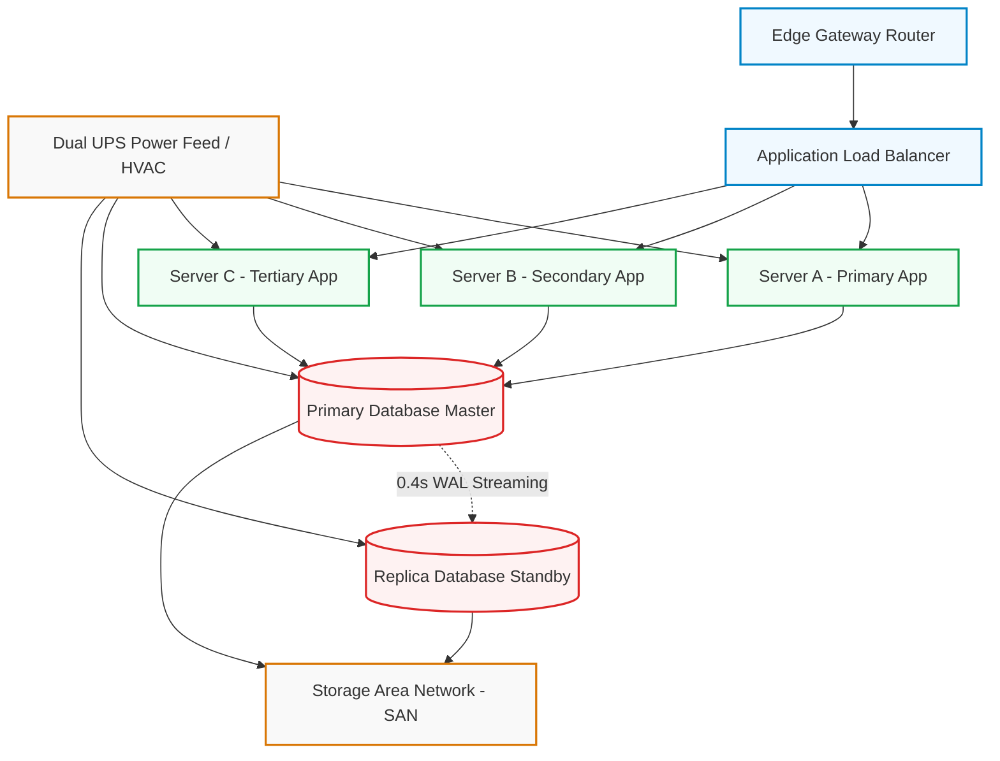
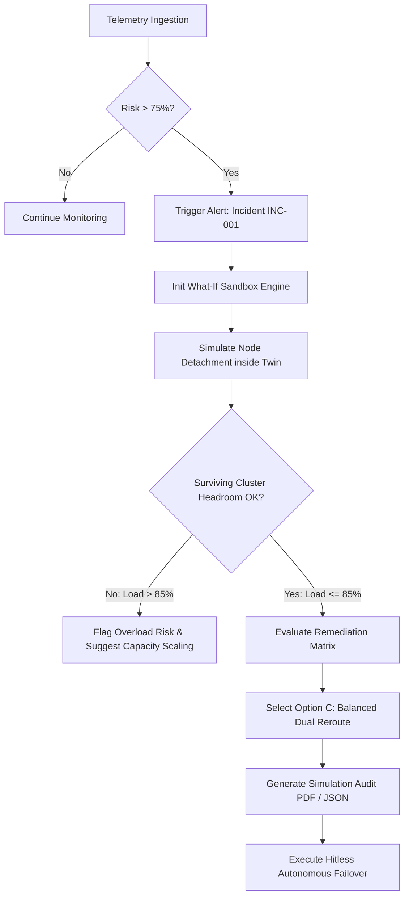

# 🌐 Autonomous Infrastructure Digital Twin
### Predictive Simulation & Resilience Optimization for Enterprise Data Centers

[](https://python.org)
[](https://fastapi.tiangolo.com/)
[](https://react.dev/)
[](https://www.typescriptlang.org/)
[](https://vitejs.dev/)
[](https://tailwindcss.com/)

---

## 📌 Executive Summary

Modern enterprise data centers are vulnerable to complex cascading failures where a single component outage can trigger system-wide downtime. 

**Autonomous Infrastructure Digital Twin** solves this by maintaining a graph-based, real-time digital replica of physical data center topology. By combining continuous multi-sensor telemetry monitoring with a virtual sandbox execution engine, the platform predicts failures before they occur and computes optimal load-redistribution strategies without touching production systems.

> **Key Innovation:**  
> *"Before making a change or waiting for equipment failure, we simulate it inside the Digital Twin, predict its downstream consequences, evaluate cluster headroom, and autonomously identify the safest response."*

---

## 🔄 System Flowcharts & Architecture

### 1. High-Level Operational Loop
The platform continuously runs telemetry through risk evaluation, sandbox simulation, headroom verification, and autonomous execution.

```
       ┌───────────────────────────────┐
       │   Real/Simulated Telemetry    │
       └──────────────┬────────────────┘
                      │
                      ▼
       ┌───────────────────────────────┐
       │     Digital Twin Graph        │
       │    (NetworkX Topology)        │
       └──────────────┬────────────────┘
                      │
                      ▼
       ┌───────────────────────────────┐
       │ Multi-Sensor Anomaly Engine   │
       │  (Calculates Failure Risk)   │
       └──────────────┬────────────────┘
                      │
                      ▼
       ┌───────────────────────────────┐
       │    Blast Radius Calculator    │
       │  (Maps Upstream/Downstream)   │
       └──────────────┬────────────────┘
                      │
                      ▼
       ┌───────────────────────────────┐
       │  What-If Sandbox Simulation   │
       │ (Detaches Nodes virtually)    │
       └──────────────┬────────────────┘
                      │
                      ▼
       ┌───────────────────────────────┐
       │    Cluster Headroom Check     │
       │    (Validates <85% Limit)     │
       └──────────────┬────────────────┘
                      │
                      ▼
       ┌───────────────────────────────┐
       │   Autonomous Safe Response    │
       │ (0-Downtime Traffic Reroute)  │
       └───────────────────────────────┘
```

---

### 2. Infrastructure Graph Topology
The diagram below maps physical hardware nodes and their power, network, and database dependencies inside the Digital Twin model.



---

### 3. Incident Decision & Mitigation Flowchart
When an anomaly is detected on a primary node, the system uses the decision process below to determine and execute the safest action.



---

## ✨ Core Functional Modules

### 1. Executive Operations Dashboard
* **Real-time KPI Tracking**: Monitors total infrastructure health (11 nodes), active warnings, critical alarms, system load, and an aggregated **Resilience Score** ($88/100$).
* **Continuous System Pulse**: Live visual indicators for telemetry jitter and background ticker synchronization.

### 2. Interactive Digital Twin Topology
* **SVG Canvas Engine**: Hardware graph view with interactive pan, zoom ($70\%-140\%$), status badges (🟢 Healthy, 🟡 Warning, 🔴 Critical, ⚫ Offline), and animated Bezier packet flows.
* **Cascading Inspector**: Click any component node to calculate real-time upstream feeds, downstream consumers, hardware specs, and local blast radius.

### 3. Predictive Anomaly & Risk Engine
Transparent multi-sensor scoring dynamically computes failure probability for every cluster component:

$$\text{Risk Score} = 0.28 \cdot \text{Temp} + 0.27 \cdot \text{CPU} + 0.22 \cdot \text{ErrRate} + 0.13 \cdot \text{Traffic} + 0.10 \cdot \text{Mem}$$

* **Risk Tiers**: Safe ($0\text{--}20\%$), Warning ($21\text{--}50\%$), High Risk ($51\text{--}75\%$), and Critical ($76\text{--}100\%$).
* **Diagnostic Narratives**: Automated plain-language diagnostic descriptions explaining multi-sensor triggers (e.g., thermal runaway vs. memory leak).

### 4. Virtual What-If Scenario Sandbox
Executes impact simulations inside the graph model with zero production risk:
* **Server Node Outage**: Simulates detaching node `Server A` and calculates redirected traffic pressure on `Server B` and `Server C`.
* **Database Failover**: Tests 0.4s WAL replication latency and sub-12s automated standby promotion.
* **Environmental Failures**: Simulates precision cooling HVAC failure across adjacent rack zones.
* **Headroom Safeguards**: Verifies surviving cluster nodes remain below the $85\%$ compute ceiling before recommending failover plans.

### 5. Scenario Comparison Matrix
Evaluates alternative remediation routes side-by-side to eliminate human error during incidents:

| Strategy | Risk Score | Operational Impact | Headroom / Load Profile | Recommendation |
| :--- | :---: | :--- | :--- | :---: |
| **Option A (Do Nothing)** | **89%** | 15–45 min ungraceful service outage | N/A (Server A crash) | 🔴 Unsafe |
| **Option B (Shift to Server B)** | **68%** | Instant failover; single point of failure | Server B overloaded at **98%** | 🟡 Warning |
| **Option C (Dual Distribution)** | **18%** | Hitless 0s transition | Server B at **82%**, Server C at **79%** | 🟢 **Safest Action** |

### 6. Audit Logging & Export Engine
Generates detailed PDF, JSON, and print-ready simulation audit reports recording pre/post resilience score deltas ($72\% \rightarrow 88\%$) and complete propagation paths.

---

## 🛠️ Tech Stack

### **Backend Core**
* **Python 3.11**: Primary runtime engine.
* **FastAPI + Uvicorn**: High-performance asynchronous REST API & background telemetry ticker.
* **NetworkX**: Directed dependency graph engine and graph blast radius solver.
* **SQLite + Pydantic v2**: Persistent telemetry, incident logs, and strict schema contracts.

### **Frontend Interface**
* **React 18 + TypeScript + Vite**: Fast, type-safe web frontend.
* **Tailwind CSS**: Enterprise dark cyber-ops design system.
* **Recharts**: Interactive real-time time-series telemetry visualizations.
* **Lucide React**: Operational iconography.

---

## 🚀 Quick Start Guide

### Prerequisites
* **Python**: `3.11+`
* **Node.js**: `18.0+`
* **npm**: `9.0+`

### Option 1: One-Click Startup (Recommended)

Run the included automated launcher script:

```powershell
# PowerShell (Windows)
.\run.ps1
```

Or double-click `run.bat` to launch both backend and frontend servers automatically.

---

### Option 2: Manual Setup

#### 1. Backend Setup
```bash
# Navigate to backend directory
cd backend

# Install dependencies
pip install -r requirements.txt

# Start FastAPI application
python -m uvicorn app:app --host 0.0.0.0 --port 8000 --reload
```
* **API Documentation**: Accessible at `http://localhost:8000/docs`

#### 2. Frontend Setup
```bash
# Navigate to frontend directory
cd frontend

# Install dependencies
npm install

# Start Vite development server
npm run dev
```
* **Web Interface**: Accessible at `http://localhost:5173`

---

## 🎯 Hackathon & Demo Presentation Flow

If presenting to judges or stakeholders, use the built-in **"Judge Demo Tour"** mode located on the top navigation bar:

1. **Step 1 (Baseline)**: System operates normally with high overall health ($94\%$).
2. **Step 2 (Anomaly Detection)**: Observe thermal runaway and CPU spike warning on `Server A` (Failure Risk: $87\%$).
3. **Step 3 (Topology Inspection)**: Navigate to the Digital Twin view to inspect glowing critical indicators and dependency lines.
4. **Steps 4 & 5 (What-If Execution)**: Virtualize `Server A` detachment without causing real-world downtime.
5. **Steps 6 & 7 (Cascading & Headroom Analysis)**: Review how the system redistributes load across `Server B` ($82\%$) and `Server C` ($79\%$).
6. **Step 8 (Scenario Matrix)**: Compare remediation routes to prove why balanced distribution is optimal.
7. **Steps 9 & 10 (Autonomous Action & Audit)**: Accept the autonomous recommendation and download the final PDF simulation audit report.

---

## 📄 License

Distributed under the **MIT License**. See `LICENSE` for more details.